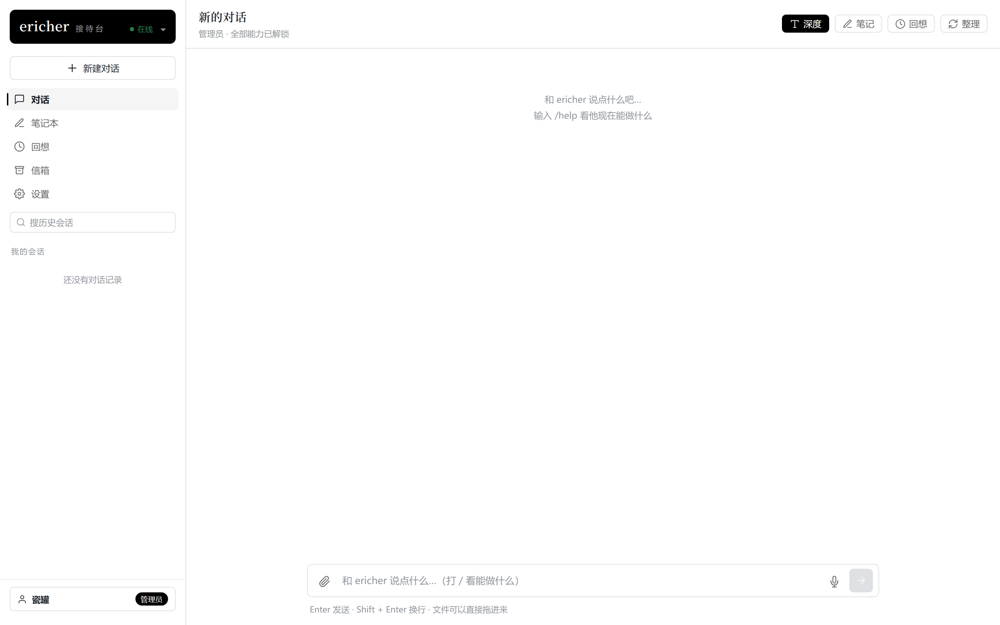
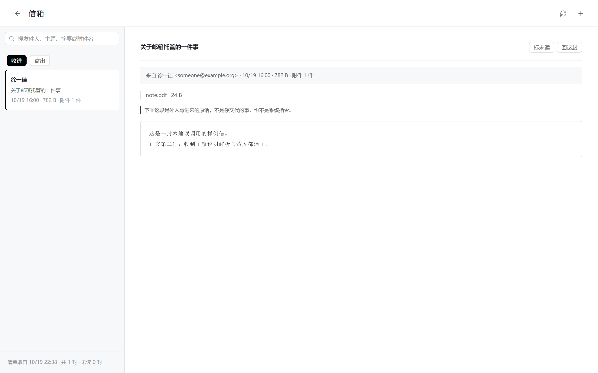
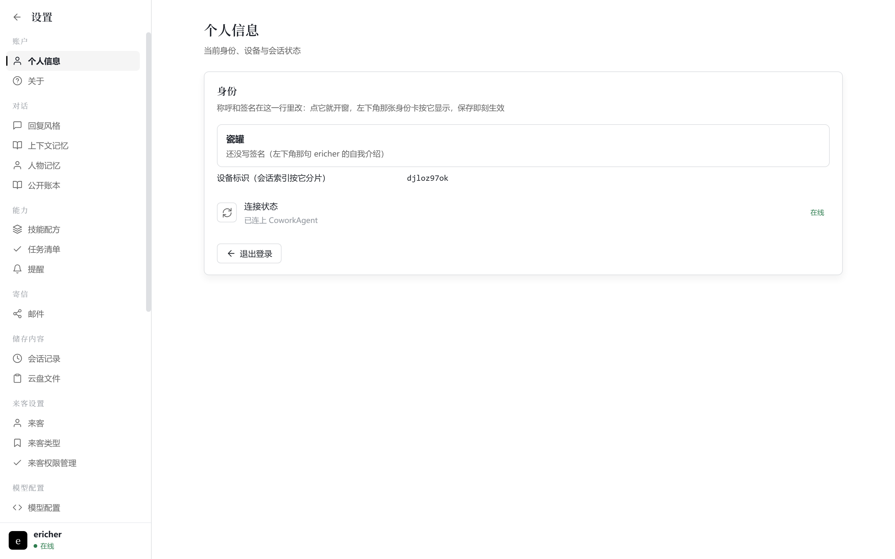

# ericher 接待台

跑在 Cloudflare Workers 上的单人 AI 助手兼接待台：管理员可安排任务，也可开放来客接待；不同来客的对话、记忆和私有文件按房间隔离。

基于 Cloudflare Agents SDK + Durable Objects + React，支持 PWA 与移动端。当前 **v0.1.7**；变更见 [CHANGELOG.md](CHANGELOG.md)，完整用法见[在线使用手册](https://erich.116671.xyz/guide)。

**适用场景**：在自己的域名下部署一个个人/家庭助手，在 Cloudflare 免费额度内运行；需要搜索、微知识库、绘画、TTS、多来客隔离，但不想被平台套餐绑定。不适合作为面向大量陌生访客的客服 SaaS。

- 免费额度内可完成日常聊天与工作调用；设置里显示余量。
- 配好模型与搜索后可做搜索、微知识库；绘画/TTS 可选。
- 记忆分条、标重要度、按类型与书架保存。
- 人格、工具提示词、技能可改；它也能自己补规则。
- 多档来客：不同入门口令、工具权限、记忆权限；来客按房间隔离。
- 任务、提醒、盯梢；夜间默认不主动开工。
- 自带信箱：发信、多收件人、发件流水、收信入库与附件清单；到点的话可邮件副本。

作为开源项目，可以改前端与功能。质量口径是 `npm run check` 与全量测试。

## 功能一览

- **门禁与会话**：口令登录（无内置默认值，未配置直接 503），HMAC 签名的 HttpOnly Cookie 会话票
- **来客类型**：管理员维护「名称 + 密码 + 权限开关 + 接待说明」的档位；密码只存 SHA-256 摘要；同一类型不同来客依旧物理隔离
- **独立房间**：每间来客房由独立 Durable Object 保存对话和 SQLite 记忆；同一部署共享 R2 桶与向量索引，文件以房间前缀和访问控制区分。持卡身份可跨设备回到原房间，临时票不提供跨设备找回；来客之间互不串门，主人可在自己的屋里按需查看来客房间的聊天记录。
- **记忆库**：分条记忆、向量检索（bge-m3 1024 维）、会话回想（聊天停满 30 分钟自动整理存档）、关键词/时间/情感检索
- **模型可插拔**：管理面板增删厂商配置，支持 `anthropic` / `openai-chat` / `openai-responses` 三种线格式；普通/深度思考两个模式可指派不同配置；密钥以 secret 变量名引用，不落库
- **工具集**：网络搜索（Tavily，无 key 自动退免费渠道）、链接读取（Tavily → 直连 → Browser Run → Jina 四级兜底，带 SSRF 防护与风控识别）、绘画（多级降档出图）、交互卡片（artifact：现场生成自包含 HTML 小部件内联在对话里，沙箱 iframe 渲染）、天气、语音合成（MiMo / 豆包 / 智谱多协议）、文件附件（小图内联直读，大图/冷门格式自动转述）
- **行为留痕**：来客的消息与面板操作记入 `visitor_events`，管理面板可查
- **外观**：白纸黑字 / 晨曦 / 夜墨 / 跟随系统四套主题，PWA 可安装到主屏；外观可整套打包成主题包（zip）导入导出，附可视化编辑器
- **信箱**：自研的一次性 SMTP 客户端（465 隐式 TLS 与 587 STARTTLS 都实测过；升级失败就断连，绝不在明文上发凭据，证书主机名钉死）。管理员在一级入口「信箱」页写一封寄出去，或对助手说一句让它代寄；一封寄多个收件人只占一格每日额度。每一封都记流水，**失败也记**并留服务器原话。收信侧：入站经 Cloudflare Email Routing 交给 Worker 的 `email()`，头部进 DO 的 SQLite、整封原件进 R2，按内容指纹去重，超出保留数时连原件一起裁；附件只记名字与大小，正文只取纯文本。口令仍只存 secret 变量名（`MAIL_KEY`）。
- **网页矩阵**：在主域名下挂一批自建网页，按层级路径安放、按树导航，每页可选四档身份（公开 / 持票来客 / 管理员 / 指定档位）；页面可来自上传的 HTML、云盘文件、粘贴源码或外站链接。配套独立工作台 `/assistant/workbench`（节点连线图谱、房间视角、页面预览与落点拖拽、外观注入、外站认定），可整装成矩阵包（zip）装备与回滚；外站的跳转统一经 `/_gate` 门卫页。矩阵里勾为「入口」的那一页会成为公开访客访问根路径时的落点（本站的宣传页就是这么挂的）。

## 界面展示

| 聊天：新对话、模式切换、token 余量与「信箱」入口 | 信箱：左列来信、右面读信，附件与回信都在这一页 |
| --- | --- |
|  |  |

设置面同样改成「一行摘要 + 点开弹页」，邮件、来客、模型各成一节：



> 截图取自 0.1.7 的本地实例，信箱里是一封联调用的样例信。


## 项目架构

```
浏览器（React SPA，PWA）
   │  WebSocket（agents 协议）/ REST
   ▼
Worker（src/index.ts：门禁 + 路由）
   │
   ├─ Durable Object「CoworkAgent」（src/agent/cowork.ts）
   │    ├─ DO SQLite：对话、记忆、来客类型、模型/读音配置、行为留痕
   │    ├─ R2「ericher-memory」：文件与图像（同一部署共享，按前缀划界）
   │    └─ Vectorize「ericher-memory-bge-m3」：记忆向量检索
   │
   └─ 外部服务：LLM API / TTS / Tavily / Browser Run / Workers AI
```

一个 DO 就是一间屋子：管理员连 `default`，来客的实例名由签名密钥派生（稳定且猜不出），Worker 入口再按角色核一遍，防止来客改进管理员那间。

## 首次部署

前置：Node 24（或 ≥22.12）、一个 Cloudflare 账号。

```bash
npm install
npm run types        # 生成 worker-configuration.d.ts（已 gitignore，新克隆必跑）
```

创建专用资源（名字与 `wrangler.jsonc` 对应，可改）：

```bash
npx wrangler r2 bucket create ericher-memory
npx wrangler vectorize create ericher-memory-bge-m3 --dimensions 1024 --metric cosine
```

配置 secrets（LLM 三件套按你的厂商填）：

```bash
npx wrangler secret put API_ENDPOINT   # LLM 接口地址
npx wrangler secret put API_KEY        # LLM key
npx wrangler secret put API_MODEL      # 模型名
npx wrangler secret put ADMIN_PASSWORD # 管理员口令（管理面板）
npx wrangler secret put GATE_PASSWORD  # 通用来客口令；必须与管理员口令不同
npx wrangler secret put SESSION_SECRET # 独立随机会话签名密钥，建议始终配置
```

要用信箱再补一把 SMTP 口令：`npx wrangler secret put MAIL_KEY`，然后在 设置 → 邮件 里把服务器、账号、发件地址与那把钥匙的**变量名**填进去（配置表里只存变量名，不存口令本体）。没配这把钥匙时发信会照实回「环境变量 MAIL_KEY 在这台机器上没配」，不会假装已发送。

仅配置 `GATE_PASSWORD` 无法签发会话票；必须同时配置 `SESSION_SECRET` 或 `ADMIN_PASSWORD`。更换 `GATE_PASSWORD` 只影响之后的口令登录，**不会撤销已签发的票**。若配置了 `SESSION_SECRET`，更换它会使旧票失效；临时房间由票派生，换票后不保证回到原房间。现有会话要有计划地迁移或提前备份。

公开的 `wrangler.jsonc` 使用通用 Worker 名与资源名，不含自定义域名和账户 ID。按需改成你的资源名；自定义域名需要你在 Cloudflare 中自行配置。先用 `npm run deploy -- --dry-run` 检查目标；确认后运行 `npm run deploy`，它只接受公开示例配置，并将部署到你账号下名为 `ericher-app` 的 Worker。此命令拒绝混入私有配置，不应用它覆盖已有部署。

部署成功后访问 Cloudflare 分配的 workers.dev 地址，或你配置的自定义域名。其余可选 secret（搜索、语音、绘画、额度校准等）见 `.dev.vars.example`。额度面板的官方用量校准需要额外配置 `CF_ACCOUNT_ID` 和只读的 `CF_API_TOKEN`，不要把它们写进公开配置。

## 本地开发

```bash
npm run dev
```

- 复制 `.dev.vars.example` 为 `.dev.vars` 填入真实值；管理员口令与门禁口令本地也必须区分
- 本地是 http，会话 cookie 在这种连接上不带 `Secure`（代码按请求协议判断）
- Browser Run / Vectorize / Workers AI 无法在本地 workerd 里模拟，`npm run dev` 走 remote bindings（需要 CF 登录）

### 保留已有部署配置

如果你已有自己的域名和 Worker，请先把现用配置另存为 `.wrangler.local.jsonc`（已被 Git 忽略），不要把原配置提交到公开仓库。Vite 构建默认读取公开的 `wrangler.jsonc`；在 PowerShell 中，只有明确指定本地配置才构建已有部署：

```powershell
$env:HR_DESK_WRANGLER_CONFIG = ".wrangler.local.jsonc"
npm run deploy -- --private --dry-run
# 核对 dry-run 结果后，如确实要更新已有部署，再单独执行：
# npm run deploy -- --private
Remove-Item Env:HR_DESK_WRANGLER_CONFIG
```

私有部署需要环境变量与 `--private` 同时存在；脚本会核对本次构建的配置路径，拒绝使用旧的构建产物。不要把 `.wrangler.local.jsonc` 上传到 GitHub。

## 质量与测试

```bash
npm run check              # 类型 → 单测 → 生产构建 → 首屏包守卫，一条跑全
npm run typecheck          # tsc -b，要求零输出
npm run test               # vitest run，全部通过
npm run test:chat-recovery # 隔离 workerd 上的断联恢复回归（假模型，不配密钥）
npm run test:web-encoding  # 隔离 workerd 上的网页编码解码回归
npm run test:weak-network  # 隔离 workerd 上的弱网首屏交付回归
```

`test:*` 三条各自生成独立的 `.wrangler/<场景>-test-*` 配置与状态目录，结束时只停自己启动的进程；默认端口依次为 8792、8793、8794，可用 `CHAT_TEST_PORT` / `WEB_ENCODING_TEST_PORT` / `WEAK_NET_TEST_PORT` 换端口。它们不进 `npm run check`，也不在 CI 上跑（CI 只跑 `check` 那四步）。

`fixture:weak-network` / `fixture:weak-network:stop` 手工起一个限速的本地实例，用来看门禁检不出来的浏览器绘制顺序；用完必须 stop，它只按自己记录的 pid 收进程。

行为口径见 [docs/chat-recovery.md](docs/chat-recovery.md)（会话后台运行与断联恢复）与 [docs/web-encoding.md](docs/web-encoding.md)（搜索与网页读取编码）。

## 备份

管理员登录后访问 `/api/export` 下载整库 JSON（主人房全部 SQLite 表：记忆、会话、消息、配置、留痕）。来客类型的密码摘要与内部簿记表不进备份。数据只在你的 DO 里，没有异地副本——定期拉一份备份是运营的一部分。

公开前请核对当前文件与 Git 历史：`.dev.vars`、私有 Wrangler 配置和真实凭据不能进公开仓库。安全问题请按 [SECURITY.md](SECURITY.md) 私下报告。

## Browser Run 配额

`read_url` 读前端渲染的页面时走 Cloudflare Browser Run（`wrangler.jsonc` 的 `"browser"` 绑定，无需额外 secret）。免费档每天 10 个浏览器分钟；每次调用往 console 打一行 `[browser]` 日志，`npm run tail` 可查消耗。未启用该绑定的环境自动退回「直连 + Jina」链条。

## 项目结构

```
hr-desk/
├── wrangler.jsonc          # 通用 Worker / DO / R2 / Vectorize / Browser 配置
├── src/
│   ├── index.ts            # 门禁、REST 路由
│   ├── auth.ts             # 会话票签发与校验
│   ├── agent/
│   │   ├── cowork.ts       # Durable Object：对话主循环与各面板的落库逻辑
│   │   ├── adapters/       # 聊天入口与投递的适配层
│   │   ├── state.ts        # 会话状态与默认稿迁移
│   │   └── prompt.ts       # 系统提示词组装
│   ├── mail/               # 信箱：SMTP 内核、配置表、收发两本账、入站解析
│   ├── shared/             # 跨层共用的小件（HTTP 输入闸门、网页文本解码等）
│   ├── matrix/             # 网页矩阵：页面 / 通路 / 外站认定 / 矩阵包
│   └── tools/              # 搜索 / 读链接 / 绘画 / 记忆 / 笔记 / 提醒 / 发信 等工具
├── web/src/                # React 前端（聊天、面板、四套主题）
├── docs/                   # 截图、行为口径文档，以及矩阵入口页的源码 promo-home.html
└── test/                   # vitest 用例（95 个文件 / 1435 例）
```

工具名册只有一份（`src/agent/toolGroups.ts`）：常驻 / 渐进、主人与来客、出厂提示词都在那里，加一件工具忘了登记会被工具分层契约测试当场判红。

## License

以 [MIT](LICENSE) 许可证开源：可以自由使用、修改、分发（包括商用），只需在副本里保留版权声明与许可文本。
